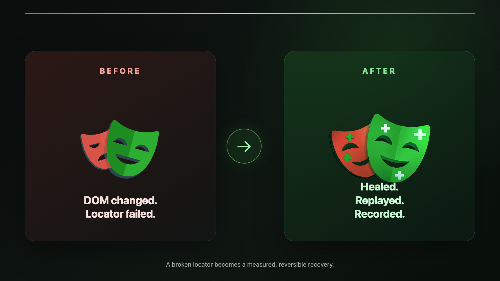
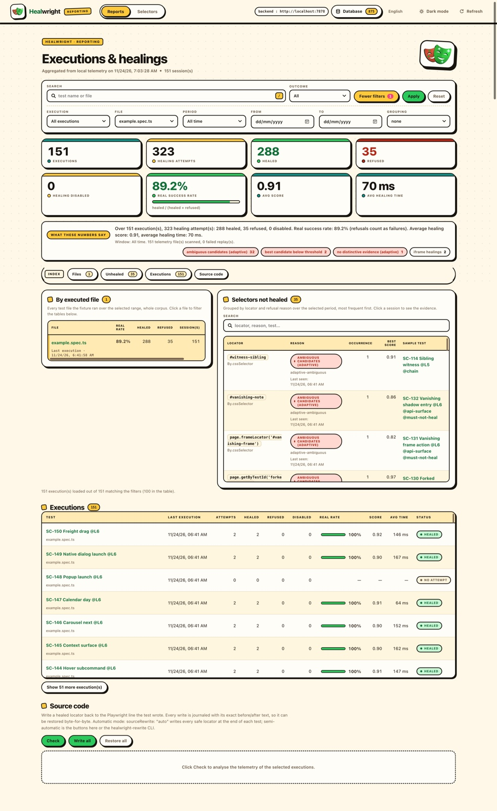

<p align="center">
  
</p>

<p align="center"><strong>Self-healing locators for Playwright — local, measured, and reversible.</strong></p>

<p align="center">
  
  
  
  
  
  
  
  
</p>

<p align="center">
  <a href="https://zouhairelma.github.io/Healwright/">Documentation</a> ·
  <a href="https://www.npmjs.com/package/@zouhair_elmattad/healwright">npm</a> ·
  <a href="https://github.com/zouhairElMa/Healwright/releases">Releases</a> ·
  <a href="https://www.linkedin.com/in/zel2351/">LinkedIn</a>
</p>

<p align="center">
  
</p>

> 🎭 **Now, the mask on the right is healed!** Finally 😷, it has got its smile back thanks to Healwright. 😁

Healwright adds self-healing locators and resilient tests to Playwright. The healing engine runs inside the Playwright process; a local Java backend provides persistence, reporting, and journaled source rewriting.

The backend and dashboard are distributed as one executable jar. Docker is not required at runtime.

## Why Healwright

Healwright began during a **client consulting assignment** focused on stabilizing flaky Playwright regression suites. Every release could change the application DOM, break locators, and force engineers to spend more time maintaining test scripts. That maintenance increased automation cost, engineering effort, and delivery time. LLM-based approaches added another concern: token consumption and confidentiality policies that did not always allow test code or application data to leave the client environment.

The project set out to build a robust, industrializable, locally executable alternative. Healwright combines a machine-learning classification model with comparative HTML DOM analysis, confidence scoring, and captured evidence. Core healing runs locally, independently of LLMs, and does not require an Internet connection, so project data can remain inside the trusted environment.

Healwright is designed to **refuse uncertain repairs**, not merely click a plausible replacement. Runtime recovery, visual evidence, telemetry, reporting, and reversible source rewriting form one measurable workflow that supports fully automatic or explicitly confirmed source changes.

Read the full [project story](docs/story.md) and the [acceptance-testing methodology](docs/acceptance-testing.md).

## Features

- Replays a failed Playwright action once against a healed locator.
- Supports CSS and XPath selectors, iframes, open shadow roots, and web-first assertions.
- Provides an embedded reporting dashboard and local JSONL evidence.
- Rewrites safely healed locators back into Playwright source by default.
- Keeps every source rewrite inside an explicit backend allowlist and records a reversible journal.
- Uses measured `adaptive` scoring by default while keeping `scoreCap: 0.6` and the legacy profiles selectable.

## Built for industrial Playwright automation

1. **Measured locator recovery** — classify failures, compare DOM candidates, score confidence, capture visual evidence, and replay a supported action once.
2. **Complex DOM scenarios** — cover iframe remounting, structural changes, open shadow roots, CSS, XPath, and web-first assertions within documented boundaries.
3. **Source-code recovery** — inspect exact before/after diffs, apply safe measured changes automatically or after confirmation, and restore the original locator from a reversible journal.
4. **Telemetry and traceability** — record failed locators, candidates, scores, decisions, timings, replay outcomes, and source positions locally.
5. **Reporting and analytics** — review sessions, per-file results, healing attempts, refusal reasons, captures, and source changes in one dashboard.

## Acceptance and evidence

The historical acceptance campaign analyzed **640 executions** and **815 healing attempts**: **712 healed**, **103 refused**, and an **87.4% measured success rate**, with a 0.88 average score and 145 ms average healing time. The evaluation used a Three-Point Estimation frame and scenarios aligned with ISTQB practices. These are historical campaign figures, not the final 0.2.1 release benchmark.

The final 0.2.1 benchmark is reported separately: **119/128 passed**, 9 known failures, and the reproducible IF-04 nested-frame regression. Healwright treats refusal as a safety feature when candidates are ambiguous, confidence is insufficient, or evidence is not distinctive enough.

See [Acceptance testing](docs/acceptance-testing.md) for the method, formulas, testing workflow, historical results, and final release evidence.

## Reporting at a glance



The embedded dashboard exposes sessions, test files, candidates, scores, refusal reasons, captures, timings, and exact source diffs. The screenshot is an illustrative local session, not the final 0.2.1 benchmark. See [Reporting](docs/reporting.md) for configuration and audit mode.

## Requirements

- Node.js 20 or newer.
- Playwright and `@playwright/test` 1.40 or newer. Version 1.65.x was verified locally.
- Java 21 for the backend.
- PostgreSQL accessible to the backend. PostgreSQL 13.0 was verified locally; other versions are not yet verified.

## Default deployment profile

A fresh installation uses healing enabled, `scoreCap: 0.6`, one recovery attempt, measured `adaptive` scoring, a 2-second action timeout, reporting enabled, and automatic source rewriting. The npm backend launcher defaults to port `7878`, database and schema `healwright`, user `healwright_user`, metrics disabled, the project report directory, and the project rewrite allowlist. Only `SPRING_POSTGRES_PASSWORD` is mandatory.

The verified Playwright profile keeps a 120-second total test timeout. Its 2-second action timeout is now the built-in Healwright default. These are test-runner settings, not scoring thresholds. See [Configuration](docs/configuration.md#recommended-default-profile) for the complete parameter table and override rules.

For an existing Playwright suite, use the [recommended custom fixture](docs/getting-started.md#recommended-fixture-for-an-existing-suite) so every action runs through `healedPage` with the measured production profile.

## 1. Install the client

Run these commands in the Playwright project root:

```bash
npm install @zouhair_elmattad/healwright
npm install -D playwright @playwright/test
npx playwright install chromium
```

## 2. Create PostgreSQL credentials

For a fresh installation, create a dedicated role and database without putting the password in shell history:

```bash
createuser --pwprompt healwright_user
createdb -O healwright_user healwright
psql -h localhost -U healwright_user -d healwright \
  -c "CREATE SCHEMA IF NOT EXISTS healwright AUTHORIZATION healwright_user;"
```

If you already have the legacy database, keep it and set the environment variables to its existing identifiers instead: `SPRING_POSTGRES_DB=healenium`, `SPRING_POSTGRES_SCHEMA=healenium`, and `SPRING_POSTGRES_USER=healenium_user`. These are database identifiers, not Healwright product names.

## 3. Start the backend from the Playwright project root

Download `healwright-backend-3.5.1.jar` from the [GitHub Releases page](https://github.com/zouhairElMa/Healwright/releases), then run:

```bash
cd /path/to/your/playwright-project

export SPRING_SERVER_PORT=7878
export SPRING_POSTGRES_DB_HOST=localhost
export SPRING_POSTGRES_DB_PORT=5432
export SPRING_POSTGRES_DB=healwright
export SPRING_POSTGRES_SCHEMA=healwright
export SPRING_POSTGRES_USER=healwright_user
export SPRING_POSTGRES_PASSWORD='<your-password>'
export HEALWRIGHT_REPORT_DIR="$PWD/.healwright/reports"
export HEALWRIGHT_APPLY_ROOTS="$PWD"
export COLLECT_METRICS=false

java -jar /path/to/healwright-backend-3.5.1.jar
```

`SPRING_POSTGRES_PASSWORD` is mandatory. Never commit it.

For a fresh installation, the npm launcher defaults to database and schema `healwright`, user `healwright_user`, port `7878`, metrics disabled, the project report directory, and `HEALWRIGHT_APPLY_ROOTS="$PWD"`. Only the password is required:

```bash
export SPRING_POSTGRES_PASSWORD='<your-password>'
npx healwright-backend --jar /path/to/healwright-backend-3.5.1.jar
```

Verify the backend in another terminal:

```bash
curl --fail http://localhost:7878/actuator/health
curl --fail http://localhost:7878/api/config
```

Open <http://localhost:7878/> for the dashboard. See the [backend guide](docs/backend.md) for Java 21 setup on macOS and Homebrew, all environment variables, and troubleshooting.

## 4. Run the verified live healing scenario

Create `tests/example.spec.ts` with the following content. This is the exact TestMu AI scenario verified with Playwright 1.65.1 and backend 3.5.1: the page changes `#username` to `#lambdatest`, Healwright heals the locator, replays the action, and rewrites the measured source callsites after the test closes.

```ts
import { test, expect } from '@zouhair_elmattad/healwright/test';

const CHANGE_BTN = 'p.selenium_btn';

test.setTimeout(120_000);

test.use({
  healOptions: {
    serverUrl: 'http://localhost:7878',
    actionTimeout: 2_000,
    className: 'LiveTestmuai',
    methodName: 'autoHealing',
    reporting: true,
    reportDir: '.healwright/reports',
  },
});

test('testmuai: heals #username -> #lambdatest and replays fill', async ({ healedPage }) => {
  await healedPage.goto('https://www.testmuai.com/selenium-playground/auto-healing/');

  await healedPage.locator('#username').fill('testuser');

  await healedPage.locator(CHANGE_BTN).click({ delay: 500 });
  await healedPage.waitForTimeout(1_000);
  await healedPage.locator(CHANGE_BTN).click({ delay: 500 });
  await healedPage.waitForTimeout(1_000);

  await healedPage.locator('#username').fill('testuser1');
  await expect(healedPage.locator('#username')).toHaveValue('testuser1');

  await healedPage.locator('#username').fill('testuser2');
  await expect(healedPage.locator('#username')).toHaveValue('testuser2');
});
```

Run it:

```bash
npx playwright test
```

The total test timeout must be longer than the action timeout. Healing starts only after the original Playwright action fails, so a 30-second total timeout can terminate the test before healing begins.

Verification evidence from the packaged `0.2.1` defaults (`adaptive`, 2,000 ms) is available in [live-testmuai-0.2.1-defaults.json](docs/evidence/live-testmuai-0.2.1-defaults.json) and [live-testmuai-0.2.1-defaults.jsonl](docs/evidence/live-testmuai-0.2.1-defaults.jsonl).

The final 128-case benchmark measured 119 passes and 9 failures. It did not reproduce the frozen rc.8 baseline exactly: 35 cases improved and the nested-frame case IF-04 regressed. The [structured results](docs/evidence/final-0.2.1-benchmark-results.json) and [IF-04 diagnostic log](docs/evidence/final-0.2.1-if04-diagnostic.log) disclose the deviation; IF-04 remains a known limitation.

Expected evidence:

- The test passes.
- `.healwright/reports/<session-id>.jsonl` contains successful `replay.ok` events for `#lambdatest`.
- The measured `#username` callsites are rewritten to `#lambdatest`, with the original expression preserved in a `// healwright:` comment.
- The rewrite journal is stored under `~/.healwright/rewrite/`.

To run the healing scenario again, restore the previous source first:

```bash
npx healwright-rewrite revert --scope last
npx playwright test
```

## 5. Use the programmatic API

```ts
import { chromium } from 'playwright';
import { heal } from '@zouhair_elmattad/healwright';

const browser = await chromium.launch();
const page = await browser.newPage();
await page.goto('https://example.com');

const healedPage = heal(page, { serverUrl: 'http://localhost:7878' });
await healedPage.locator('#submit').click();

await browser.close();
```

An element that exists but is not actionable is not healed. In `reportOnly` mode, Healwright records proposals without replaying the action and never rewrites source.

## Configuration

Configuration precedence is **user option > environment variable > default**.

| Option | Environment variable | Default |
|---|---|---|
| `healEnabled` | `HEALWRIGHT_HEAL_ENABLED` | `true` |
| `scoreCap` | `HEALWRIGHT_SCORE_CAP` | `0.6` |
| `recoveryTries` | `HEALWRIGHT_RECOVERY_TRIES` | `1` |
| `serverUrl` | `HEALWRIGHT_SERVER_URL` | `http://localhost:7878` |
| `selectorType` | `HEALWRIGHT_SELECTOR_TYPE` | `css` |
| `actionTimeout` | `HEALWRIGHT_ACTION_TIMEOUT` | `2_000` ms |
| `reportOnly` | `HEALWRIGHT_REPORT_ONLY` | `false` |
| `reportDir` | `HEALWRIGHT_REPORT_DIR` | `<cwd>/.healwright/reports` |
| `scoring` | `HEALWRIGHT_SCORING` | `adaptive` |
| `sourceRewrite` | `HEALWRIGHT_SOURCE_REWRITE` | `auto` |

The legacy `healenium` scoring profile and its equivalent `healwright` alias remain selectable for compatibility. They are not the public product name. See [configuration](docs/configuration.md) for the complete list.

## Source rewriting

Automatic rewriting is enabled by default. It still requires the backend allowlist `HEALWRIGHT_APPLY_ROOTS`; the standard launcher sets it to the current project directory, and the direct `java -jar` command above exports it explicitly.

Only measured, safely healed string-literal callsites are written automatically. Ambiguous targets, variables, unmeasured occurrences, files outside the allowlist, and report-only sessions are not rewritten automatically. Every applied edit is journaled and reversible.

Disable automatic rewriting when required:

```ts
test.use({ healOptions: { sourceRewrite: 'off' } });
```

Or use the environment:

```bash
export HEALWRIGHT_SOURCE_REWRITE=off
```

Inspect and revert changes:

```bash
npx healwright-rewrite status
npx healwright-rewrite list
npx healwright-rewrite apply --dry-run
npx healwright-rewrite revert --scope last
```

See [source rewriting](docs/rewriting.md) for the complete workflow.

## Documentation

- [Project story](docs/story.md)
- [Acceptance testing](docs/acceptance-testing.md)
- [Getting started](docs/getting-started.md)
- [API](docs/api.md)
- [Configuration](docs/configuration.md)
- [Reporting](docs/reporting.md)
- [Source rewriting](docs/rewriting.md)
- [Backend](docs/backend.md)
- [Known limitations](docs/limitations.md)
- [Migration](docs/migration.md)
- [Security](docs/security.md)
- [FAQ](docs/faq.md)
- [Changelog](docs/CHANGELOG.md)

## Security

The backend dashboard and API do not provide application authentication. Keep the backend on a trusted local network. Do not expose it directly to the Internet without an audited authenticated TLS reverse proxy.

Never commit PostgreSQL passwords, npm tokens, GitHub tokens, or `.env` files. Report vulnerabilities through [GitHub private vulnerability reporting](https://github.com/zouhairElMa/Healwright/security/advisories/new).

## Community and support

- [Contributing](CONTRIBUTING.md)
- [Code of Conduct](CODE_OF_CONDUCT.md)
- [Security policy](SECURITY.md)
- [Support](SUPPORT.md)
- [GitHub Issues](https://github.com/zouhairElMa/Healwright/issues)
- [LinkedIn — project author](https://www.linkedin.com/in/zel2351/)

## License and attribution

Healwright is licensed under the **Apache License 2.0**. See [LICENSE](LICENSE) for the license text and [NOTICE](NOTICE) for upstream attributions and modifications.

Playwright and Microsoft are trademarks of their respective owners. Healwright is an independent project and is not affiliated with or endorsed by Microsoft. The Playwright logo is used only to identify the supported test framework.
