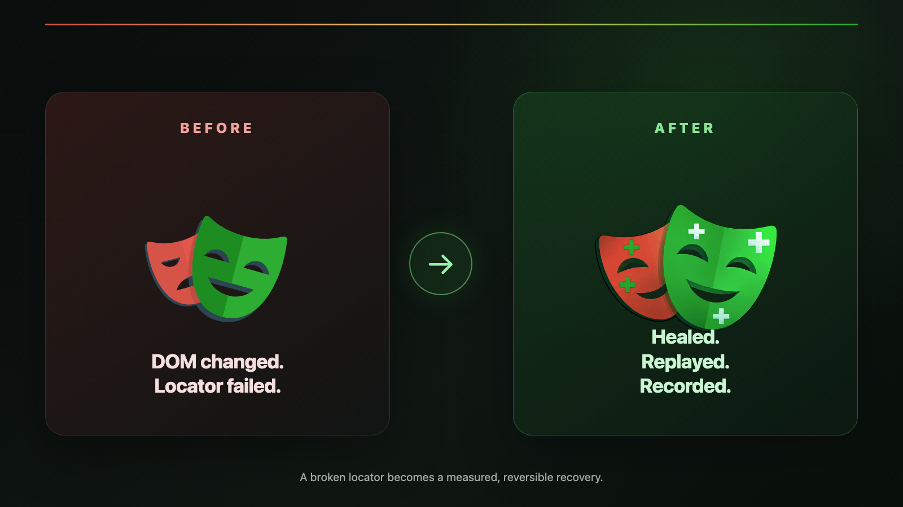
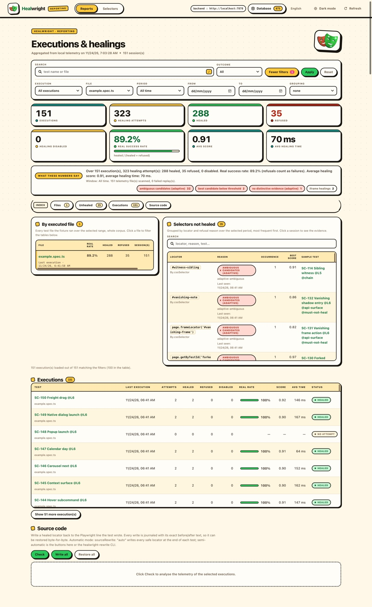

<p align="center">
  
</p>

<p align="center"><strong>Self-healing locators for Playwright — local, measured, and reversible.</strong></p>

<p align="center">
  
  
  
  
  
  
  
</p>

<p align="center">
  <a href="https://zouhairelma.github.io/Healwright/">Documentation</a> ·
  <a href="https://github.com/zouhairElMa/Healwright">GitHub</a> ·
  <a href="https://github.com/zouhairElMa/Healwright/releases">Releases</a> ·
  <a href="https://www.linkedin.com/in/zel2351/">LinkedIn</a>
</p>

<p align="center">
  
</p>

> 🎭 **Now, the mask on the right is healed!** Finally 😷, it has got its smile back thanks to Healwright. 😁

Self-healing locators and resilient Playwright tests with a local reporting backend. Healwright runs inside the Playwright process and can heal a failed locator, replay the action once, capture evidence, and safely rewrite measured source callsites.

## Why local healing?

Healwright grew from a client consulting challenge: stabilize flaky Playwright regression suites without increasing locator maintenance, automation cost, or delivery time. External and LLM-based healing services also raised token-cost and confidentiality concerns when client policies restricted sending test code or application data outside the project environment.

The result is a locally executable workflow built around a machine-learning classification model, comparative HTML DOM analysis, confidence scoring, visual evidence, and telemetry. Core healing does not require an LLM or an Internet connection. It refuses ambiguous repairs rather than clicking a plausible but incorrect target, and it supports runtime recovery plus reversible source-code changes.

Read the [project story](https://github.com/zouhairElMa/Healwright/blob/main/docs/story.md) and [acceptance-testing methodology](https://github.com/zouhairElMa/Healwright/blob/main/docs/acceptance-testing.md).

## Requirements

- Node.js 20+
- Playwright and `@playwright/test` 1.40+ (1.65.x verified locally)
- Java 21
- PostgreSQL for the backend

Docker is not required at runtime.

## Default profile

Healing is enabled with `scoreCap: 0.6`, one recovery attempt, measured `adaptive` scoring, a 2-second action timeout, reporting enabled, and automatic source rewriting. The backend launcher defaults to port `7878`, database and schema `healwright`, user `healwright_user`, metrics disabled, the project report directory, and the project rewrite allowlist. The verified Playwright profile keeps a 120-second total test timeout.

Version `0.2.2` refines publication assets and documentation only; its runtime code and defaults match the verified `0.2.1` package.

## Industrial workflow

- **Locator healing:** failed-action detection, alternative candidates, confidence scoring, visual evidence, and one controlled replay.
- **DOM resilience:** iframe remounting, structural changes, open shadow roots, CSS, XPath, and assertions within documented limits.
- **Source healing:** exact diffs, allowlisted automatic or confirmed writes, reversible journals, and original-locator restoration.
- **Traceability:** local events for failures, candidates, scores, decisions, timings, replay outcomes, and source positions.
- **Analytics:** session, file, attempt, refusal, capture, and source-change reporting with filters and search.

## Acceptance at a glance

The historical acceptance campaign covered **640 executions** and **815 healing attempts**, with **712 healed**, **103 refused**, and an **87.4% measured success rate**. Average score was **0.88** and average healing time **145 ms**. The campaign used a Three-Point Estimation frame and ISTQB-aligned scenarios; these figures are distinct from the final release benchmark.

The final 0.2.1 benchmark remains **119/128 passed**, with 9 known failures and IF-04 disclosed. See [Acceptance testing](https://github.com/zouhairElMa/Healwright/blob/main/docs/acceptance-testing.md) for the complete method and evidence boundaries.

## Reporting dashboard



The local dashboard exposes sessions, candidates, scores, refusal reasons, captures, timings, and exact source diffs. The screenshot is an illustrative local session, not the final 0.2.1 benchmark.

## Install

```bash
npm install @zouhair_elmattad/healwright
npm install -D playwright @playwright/test
npx playwright install chromium
```

## Start the backend

Download `healwright-backend-3.5.1.jar` from [GitHub Releases](https://github.com/zouhairElMa/Healwright/releases). From the Playwright project root, configure PostgreSQL and run:

```bash
export SPRING_SERVER_PORT=7878
export SPRING_POSTGRES_DB_HOST=localhost
export SPRING_POSTGRES_DB_PORT=5432
export SPRING_POSTGRES_DB=healwright
export SPRING_POSTGRES_SCHEMA=healwright
export SPRING_POSTGRES_USER=healwright_user
export SPRING_POSTGRES_PASSWORD='<your-password>'
export HEALWRIGHT_REPORT_DIR="$PWD/.healwright/reports"
export HEALWRIGHT_APPLY_ROOTS="$PWD"

java -jar /path/to/healwright-backend-3.5.1.jar
```

For a fresh installation, the npm launcher defaults to database and schema `healwright`, user `healwright_user`, port `7878`, metrics disabled, the project report directory, and the project rewrite allowlist. Only the password is required:

```bash
export SPRING_POSTGRES_PASSWORD='<your-password>'
npx healwright-backend --jar /path/to/healwright-backend-3.5.1.jar
```

Verify:

```bash
curl --fail http://localhost:7878/actuator/health
```

## Verified live Playwright test

Create `tests/example.spec.ts`:

```ts
import { test, expect } from '@zouhair_elmattad/healwright/test';

const CHANGE_BTN = 'p.selenium_btn';

test.setTimeout(120_000);

test.use({
  healOptions: {
    serverUrl: 'http://localhost:7878',
    actionTimeout: 2_000,
    className: 'LiveTestmuai',
    methodName: 'autoHealing',
    reporting: true,
    reportDir: '.healwright/reports',
  },
});

test('testmuai: heals #username -> #lambdatest and replays fill', async ({ healedPage }) => {
  await healedPage.goto('https://www.testmuai.com/selenium-playground/auto-healing/');

  await healedPage.locator('#username').fill('testuser');

  await healedPage.locator(CHANGE_BTN).click({ delay: 500 });
  await healedPage.waitForTimeout(1_000);
  await healedPage.locator(CHANGE_BTN).click({ delay: 500 });
  await healedPage.waitForTimeout(1_000);

  await healedPage.locator('#username').fill('testuser1');
  await expect(healedPage.locator('#username')).toHaveValue('testuser1');

  await healedPage.locator('#username').fill('testuser2');
  await expect(healedPage.locator('#username')).toHaveValue('testuser2');
});
```

Run:

```bash
npx playwright test
```

Keep the total test timeout longer than `actionTimeout`. Healing starts only after the original locator action fails; the remaining time covers backend lookup, replay, assertions, and teardown.

Expected evidence:

- The test passes.
- `.healwright/reports/<session-id>.jsonl` contains `replay.ok` events for `#lambdatest`.
- Safely healed measured callsites are rewritten to `#lambdatest` and journaled under `~/.healwright/rewrite/`.

To repeat the healing scenario, restore the previous source first:

```bash
npx healwright-rewrite revert --scope last
npx playwright test
```

Automatic rewriting is the default. It requires the backend allowlist, never writes report-only sessions, and can be disabled with `sourceRewrite: 'off'`.

## Programmatic API

```ts
import { chromium } from 'playwright';
import { heal } from '@zouhair_elmattad/healwright';

const browser = await chromium.launch();
const page = await browser.newPage();
await page.goto('https://example.com');

const healedPage = heal(page, { serverUrl: 'http://localhost:7878' });
await healedPage.locator('#submit').click();

await browser.close();
```

## CLI tools

```bash
npx healwright-doctor
npx healwright-backend --jar /path/to/healwright-backend-3.5.1.jar
npx healwright-report --backend http://localhost:7878 --port 7879
npx healwright-rewrite status
npx healwright-rewrite apply --dry-run
npx healwright-rewrite revert --scope last
```

## Documentation

- [Repository](https://github.com/zouhairElMa/Healwright#readme)
- [Project story](https://github.com/zouhairElMa/Healwright/blob/main/docs/story.md)
- [Acceptance testing](https://github.com/zouhairElMa/Healwright/blob/main/docs/acceptance-testing.md)
- [Getting started](https://github.com/zouhairElMa/Healwright/blob/main/docs/getting-started.md)
- [Configuration](https://github.com/zouhairElMa/Healwright/blob/main/docs/configuration.md)
- [Source rewriting](https://github.com/zouhairElMa/Healwright/blob/main/docs/rewriting.md)
- [Backend](https://github.com/zouhairElMa/Healwright/blob/main/docs/backend.md)
- [Known limitations](https://github.com/zouhairElMa/Healwright/blob/main/docs/limitations.md)
- [Security](https://github.com/zouhairElMa/Healwright/blob/main/docs/security.md)
- [LinkedIn — project author](https://www.linkedin.com/in/zel2351/)

## License and attribution

Apache-2.0. See [LICENSE](https://github.com/zouhairElMa/Healwright/blob/main/LICENSE) and [NOTICE](https://github.com/zouhairElMa/Healwright/blob/main/NOTICE) for the license text and upstream attributions.

Playwright and Microsoft are trademarks of their respective owners. Healwright is an independent project and is not affiliated with or endorsed by Microsoft.
