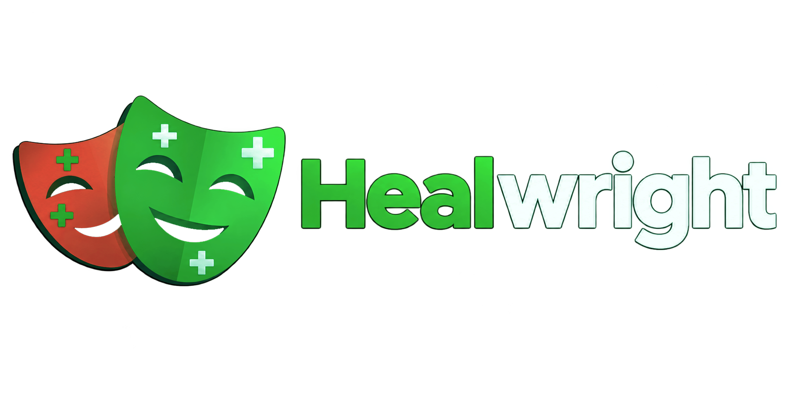
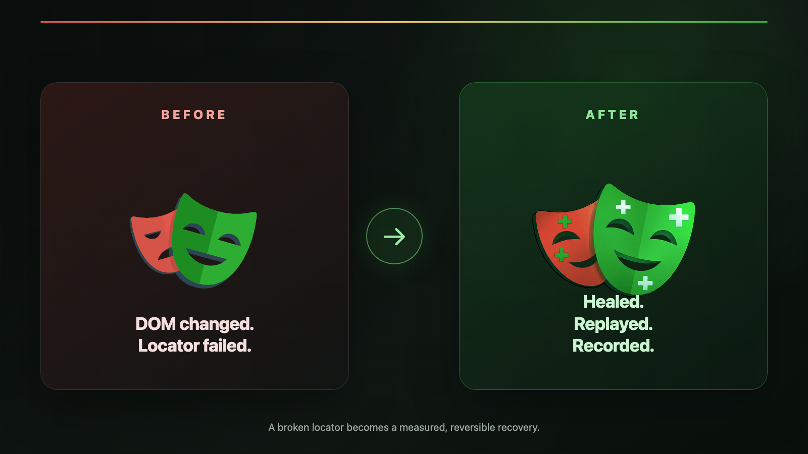
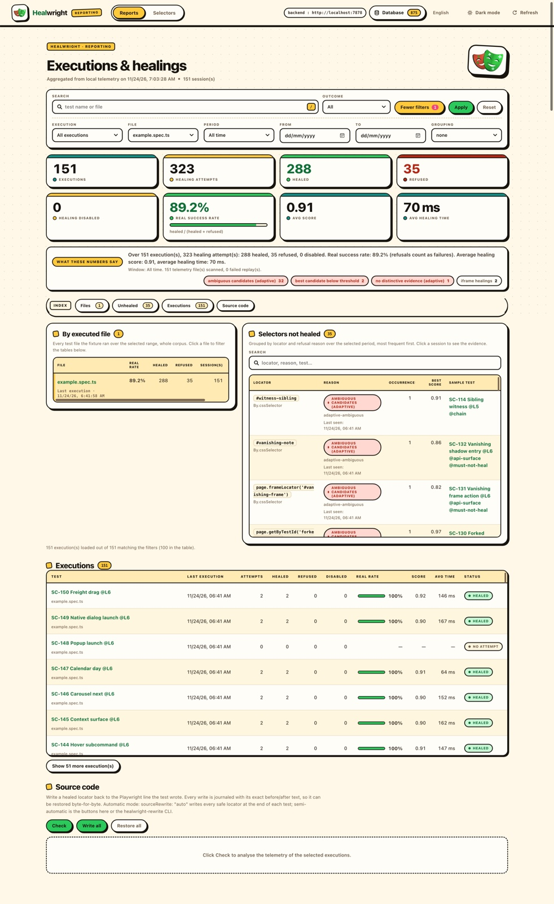

  

<strong>Self-healing locators for Playwright — local, measured, and reversible.</strong>

  
  
  
  
  
  

  <a href="https://github.com/zouhairElMa/Healwright">GitHub</a> ·
  <a href="https://www.npmjs.com/package/@zouhair_elmattad/healwright">npm</a> ·
  <a href="https://github.com/zouhairElMa/Healwright/releases">Releases</a> ·
  <a href="https://www.linkedin.com/in/zel2351/">LinkedIn</a>

  

> 🎭 **Now, the mask on the right is healed!** Finally 😷, it has got its smile back thanks to Healwright. 😁

Healwright helps Playwright tests react to DOM changes when a locator fails. The healing engine runs inside the Playwright process, while a local Java backend stores references and serves the reporting dashboard. Docker is not required at runtime.

## Why Healwright

Healwright began during a **client consulting assignment** focused on stabilizing flaky Playwright regression suites. Application releases changed the DOM, broke locators, and increased engineering effort, automation cost, and delivery time. External and LLM-based approaches raised token-cost and confidentiality concerns when client policies restricted sending test code or application data outside the project environment.

The project set out to build a robust, industrializable, locally executable alternative. Healwright combines a machine-learning classification model with comparative HTML DOM analysis, confidence scoring, and captured evidence. Core healing runs independently of an LLM and does not require an Internet connection. It refuses uncertain repairs rather than selecting a plausible but incorrect target.

Read the full [project story](story.md).

## Built for industrial Playwright automation

1. **Measured locator recovery** — classify failures, compare DOM candidates, score confidence, capture visual evidence, and replay a supported action once.
2. **Complex DOM scenarios** — cover iframe remounting, structural changes, open shadow roots, CSS, XPath, and web-first assertions within documented boundaries.
3. **Source-code recovery** — inspect exact diffs, apply safe measured changes automatically or after confirmation, and restore source through reversible journals.
4. **Telemetry and traceability** — record failures, candidates, scores, decisions, timings, replay outcomes, and source positions locally.
5. **Reporting and analytics** — review sessions, per-file results, attempts, refusal reasons, captures, and source changes in one dashboard.

## Acceptance and evidence

The historical acceptance campaign covered **640 executions** and **815 healing attempts**: **712 healed**, **103 refused**, and an **87.4% measured success rate**, with a 0.88 average score and 145 ms average healing time. The campaign used a Three-Point Estimation frame and ISTQB-aligned scenarios. These figures are distinct from the final release benchmark.

The final 0.2.1 benchmark is reported separately: **119/128 passed**, 9 known failures, and the reproducible IF-04 nested-frame regression. The [acceptance-testing methodology](acceptance-testing.md) explains the formulas, frozen expectations, deviations, testing workflow, and evidence boundaries.

## Reporting

The embedded dashboard shows sessions, test files, candidates, scores, refusal reasons, captures, timings, and exact source diffs. The screenshot is an illustrative local session, not the final 0.2.1 benchmark. See [Reporting](reporting.md) for details.

## Start here

1. [Install Healwright](getting-started.md).
2. [Start the backend](backend.md).
3. [Wrap a page or use the fixture](api.md).
4. [Review configuration](configuration.md).
5. [Inspect reports](reporting.md).

## Safety model

- A failed action is replayed at most once by default.
- `reportOnly` records proposals without replaying or applying them.
- Source rewriting is automatic by default, allowlisted, journaled, and reversible; `reportOnly` and `sourceRewrite: 'off'` disable it.
- The backend is intended for a trusted local network.

## Community

- [GitHub repository](https://github.com/zouhairElMa/Healwright)
- [Contributing](https://github.com/zouhairElMa/Healwright/blob/main/CONTRIBUTING.md)
- [Security](https://github.com/zouhairElMa/Healwright/blob/main/docs/security.md)
- [Support](https://github.com/zouhairElMa/Healwright/blob/main/SUPPORT.md)
- [LinkedIn — project author](https://www.linkedin.com/in/zel2351/)

## License

Healwright is available under the **Apache License 2.0**. Upstream attributions are preserved in the repository [NOTICE](https://github.com/zouhairElMa/Healwright/blob/main/NOTICE).

Playwright and Microsoft are trademarks of their respective owners. Healwright is an independent project and is not affiliated with or endorsed by Microsoft.
